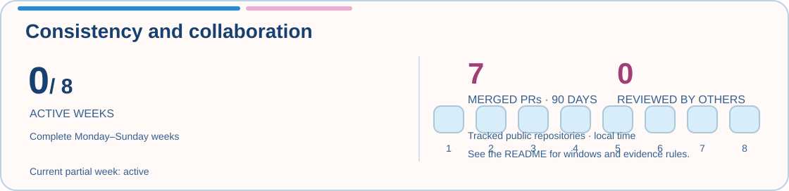
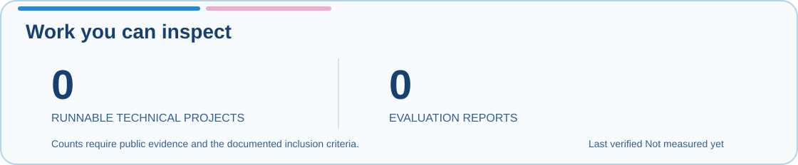

  

<a href="assets/banner-static.png">View still banner</a> · Uniform-grid pixel art with gentle cloud drift

## Rain Piao

UCLA undergraduate studying Statistics and Data Science and Applied Mathematics. I work across machine learning, computer vision, statistical modeling, and software, with an emphasis on experiments that can be inspected and reproduced.

[LinkedIn](https://www.linkedin.com/in/its-rain-piao-yay/) · [Technical project notes](https://rainnnee.github.io/rainpiao/#projects)

### Research and current builds

- **BruinML · computer vision research** — I contribute to a five-person team studying training-free detection of small unfamiliar regions in images. I extended a Python Monte Carlo study across 225 combinations of noise distributions, object geometries, and signal strengths to compare statistical detection methods. The simulations do not establish performance on real-world images.
- **ACM AI at UCLA · poker decision model** — Selected for a team developing a transformer-based model to learn player behavior from sequential game states and actions. The project is in progress; no predictive results are claimed here.
- **STATS 100A honors project · conditional diffusion** — Exploring conditional diffusion for Chinese-character images and the relationship between recognizability, noise, and stroke complexity. The work is still in the planning and scaffolding stage; the model has not been implemented or evaluated.

### Selected technical work

- **[IMC Prosperity 4](https://rainnnee.github.io/rainpiao/projects/prosperity4.html)** — Built and iterated Python adaptive mean-reversion strategies with position limits and end-of-round risk controls. My four-person team placed in the top 16% of 18,803 teams and advanced through Round 3.
- **[ASA DataFest at UCLA](https://rainnnee.github.io/rainpiao/projects/datafest.html)** — Coordinated a five-person team in a 48-hour healthcare-data challenge. Used R, ggplot2, and Spearman rank correlation to examine patient stress, social needs, and care patterns, then presented four analyses and recommendations.
- **[LiDAR traffic monitoring](https://rainnnee.github.io/rainpiao/projects/lidar-traffic.html)** — Implemented 3D breadth-first-search clustering in C++ to identify vehicles in LiDAR point clouds, form bounding boxes, and track movement across an eight-lane roadway scene.

### Repository map

- **[Rainnnee/Rainnnee](https://github.com/Rainnnee/Rainnnee)** — This profile, its measurement definitions, and the public activity dashboard.
- **[Rainnnee/rainpiao](https://github.com/Rainnnee/rainpiao)** — Source for my technical project notes and personal site, built with HTML, CSS, and JavaScript.

I’ll add course and team repositories as their public implementations are ready to inspect.

### Tools and foundations

**Programming:** Python · C++ · R · Java · JavaScript 
**Machine learning and data:** PyTorch · NumPy · pandas · scikit-learn · ggplot2 
**Development:** Git · Linux · LaTeX

**Awards:** USACO Gold Division · ACSL National Champion (two seasons)

### Progress and evidence

I’m early in building a public record here. The measures below separate work cadence from artifacts a visitor can run or examine; small values are a baseline, not a claim about ability. Private repositories and projects are not included in the counts.

<!-- METRICS-START -->

**Tracked public work · Not measured yet** · [Definitions, scope, and evidence](docs/metrics.md)

The first successful public-data collection has not run. The project and report counts are zero because the evidence ledger is empty. A failed refresh keeps the previous snapshot and date.
<!-- METRICS-END -->

**Scope:** custom counts cover the public repositories listed in [`data/tracked-repositories.json`](data/tracked-repositories.json). See [definitions, windows, and evidence rules](docs/metrics.md). The collector keeps the last successful snapshot when a refresh fails.

---

The strongest signal is the work itself: what I built, how I tested it, and what I learned from the result.
