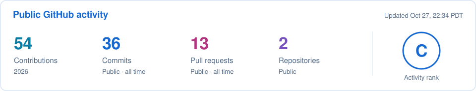
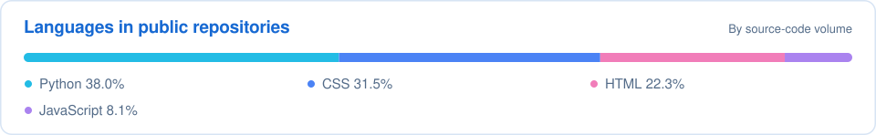

  

Artwork inspired by <a href="https://music.apple.com/us/album/piano-sessions-reflections/1700905900"><em>Piano Sessions: Reflections</em></a> (Xeuphoria × OneChilledPanda); original cover art by <a href="https://x.com/wacca005">wacca_わっか</a>.

## 🌧️ My focus

I’m studying **Statistics & Data Science and Applied Mathematics at UCLA**. I’m interested in machine learning, computer vision, and statistical inference.

- 🌱 **Currently learning:** transformers and diffusion models.
- 💻 **Experience:** Python, R, C++, and Java, plus front-end development with HTML, CSS, and JavaScript for my portfolio website.
- 🤝 **Open to collaborating on:** machine learning experiments, statistical computing, and open-source tools.
- 🏅 **Competitive programming:** USACO Gold Division and ACSL National Champion (two seasons).

## 🔭 Building &amp; exploring

- **BruinML · CLIP and computer vision** — Studying training-free detection of small unfamiliar image regions with a five-person team. My work includes Python simulations across **225 combinations** of noise distributions, object geometries, and signal strengths to compare statistical detection methods.
- **ACM AI @ UCLA · poker modeling** — Developing a transformer-based poker model with teammates to study player behavior from sequences of game states and actions. In progress.
- **STATS 100A honors · conditional diffusion** — Planning a PyTorch study of Chinese-character images, focusing on recognizability, noise, and stroke complexity.

## 🗂️ Public repositories

| Repository | What you’ll find |
| --- | --- |
| [`rainpiao`](https://github.com/Rainnnee/rainpiao) | Website source built with HTML, CSS, and JavaScript. |
| [`Rainnnee`](https://github.com/Rainnnee/Rainnnee) | This README, the banner artwork, and scripts for the contribution calendar. |

🧩 Other technical work

- **IMC Prosperity 4** — Python trading strategies, backtesting, and risk controls. Our four-person team reached Round 3 and placed in the **top 16% of 18,803 teams**.
- **ASA DataFest at UCLA** — Healthcare-data analysis with a five-person team, using **R, ggplot2, and Spearman rank correlation** to examine patient stress, social needs, and care patterns.
- **LiDAR traffic monitoring** — **C++ breadth-first-search clustering** to identify vehicles in 3D point clouds, form bounding boxes, and track movement.

## 🧰 Languages &amp; tools

**Data &amp; machine learning** 
    

**Programming &amp; statistical computing** 
   

**Development tools** 
    

**Front-end experience** 
  

## 📈 GitHub activity

<picture>
  <source media="(prefers-color-scheme: dark)" srcset="assets/github-overview-dark.svg">
  <source media="(prefers-color-scheme: light)" srcset="assets/github-overview-light.svg">
  
</picture>

<picture>
  <source media="(prefers-color-scheme: dark)" srcset="assets/github-activity-dark.svg">
  <source media="(prefers-color-scheme: light)" srcset="assets/github-activity-light.svg">
  
</picture>

<picture>
  <source media="(prefers-color-scheme: dark)" srcset="assets/github-languages-dark.svg">
  <source media="(prefers-color-scheme: light)" srcset="assets/github-languages-light.svg">
  
</picture>

Refreshed automatically about once an hour · <a href="https://github.com/Rainnnee/Rainnnee/actions/workflows/update-profile-activity.yml">Refresh status</a> · <a href="docs/profile-activity.md">Data &amp; definitions</a>

## 📬 Connect

