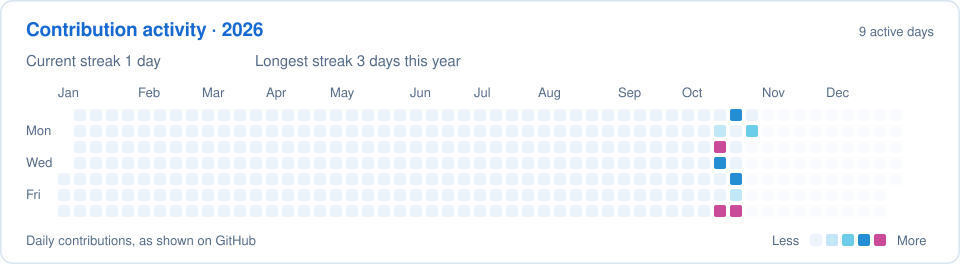

  

Inspired by <a href="https://x.com/wacca005">wacca_わっか</a>’s cover art for <a href="https://music.apple.com/us/album/piano-sessions-reflections/1700905900"><em>Piano Sessions: Reflections</em></a> (Xeuphoria × OneChilledPanda).

## 👋 About me

I’m studying **Statistics & Data Science and Applied Mathematics at UCLA**, with interests in machine learning, statistical computing, and web development.

- 🔭 **Working on:** computer vision and statistical detection with BruinML, and sequential game modeling with ACM AI at UCLA.
- 🌱 **Learning:** transformers, diffusion models, and full-stack development.
- 💻 **Coding in:** Python, R, C++, Java, HTML, CSS, and JavaScript.
- 🤝 **Open to collaborating on:** machine learning experiments, data analysis, and open-source tools.
- 🏅 **Competitive programming:** USACO Gold Division and ACSL National Champion (two seasons).
- 💬 **Ask me about:** Python, R, C++, statistical modeling, or ML experiments.

## 🧰 Languages &amp; tools I use

**Front end** 
  

**Programming &amp; statistical computing** 
   

**Data &amp; machine learning** 
    

**Development tools** 
    

## 📈 My GitHub, at a glance

  
  

  

  

Based on public GitHub activity. The rank reflects activity, and language percentages reflect repository code volume. The contribution calendar refreshes weekly.

## 🔭 What I’m building &amp; exploring

- **BruinML · CLIP and computer vision** — Studying training-free detection of small unfamiliar image regions with a five-person team. My work includes Python simulations across **225 combinations** of noise distributions, object geometries, and signal strengths to compare statistical detection methods.
- **ACM AI Projects @ UCLA · sequential game modeling** — Developing a transformer-based model with teammates to study player behavior from sequences of game states and actions. In progress.
- **STATS 100A honors · conditional diffusion** — Planning a PyTorch study of Chinese-character images, focusing on recognizability, noise, and stroke complexity.

## 🧩 Other technical work

- **IMC Prosperity 4** — Python trading strategies, backtesting, and risk controls. Our four-person team reached Round 3 and placed in the **top 16% of 18,803 teams**.
- **ASA DataFest at UCLA** — Healthcare-data analysis with a five-person team, using **R, ggplot2, and Spearman rank correlation** to examine patient stress, social needs, and care patterns.
- **LiDAR traffic monitoring** — **C++ breadth-first-search clustering** to identify vehicles in 3D point clouds, form bounding boxes, and track movement.

## 🗂️ My public repositories

| Repository | What you’ll find |
| --- | --- |
| [`rainpiao`](https://github.com/Rainnnee/rainpiao) | Website source built with HTML, CSS, and JavaScript. |
| [`Rainnnee`](https://github.com/Rainnnee/Rainnnee) | This README, the banner artwork, and scripts for the contribution calendar. |

## 📬 Connect

